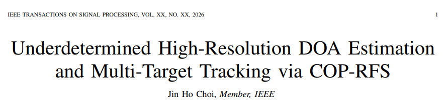
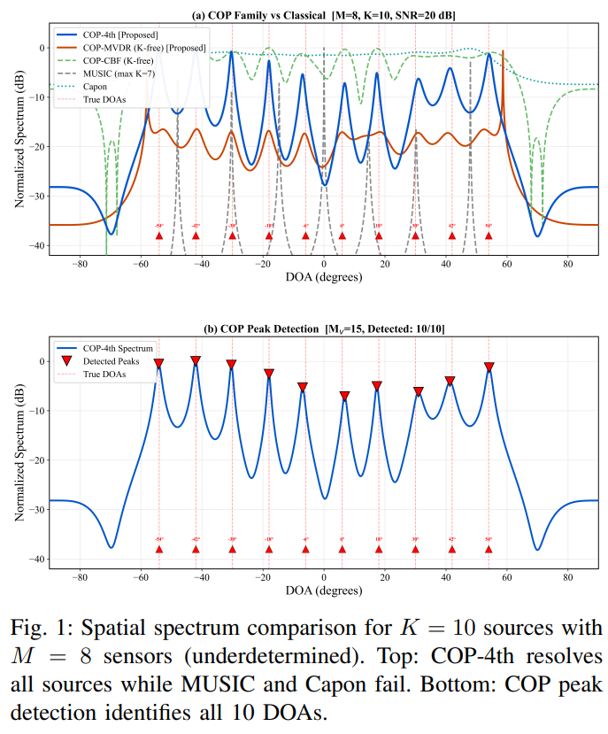
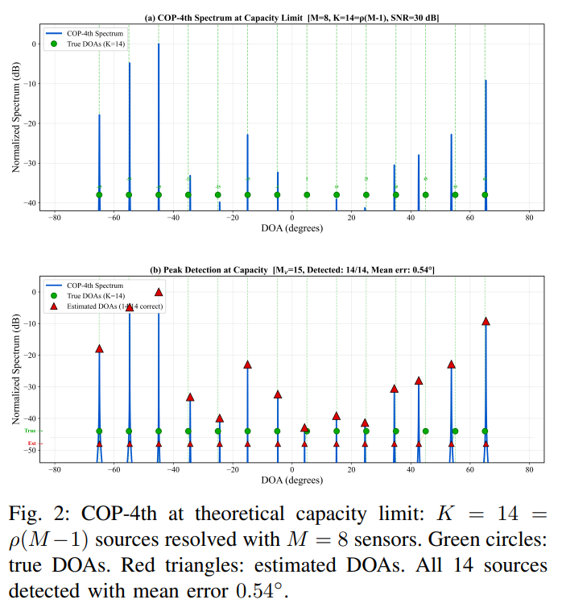
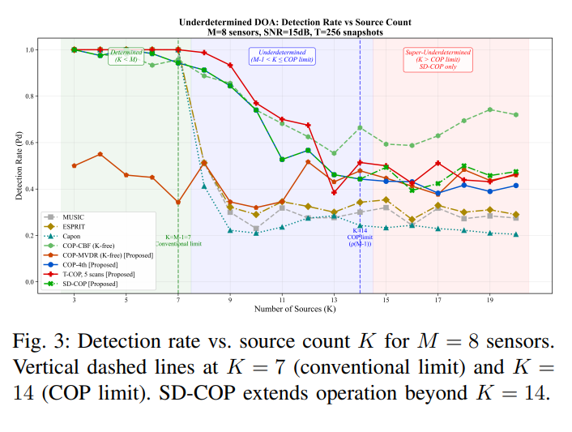
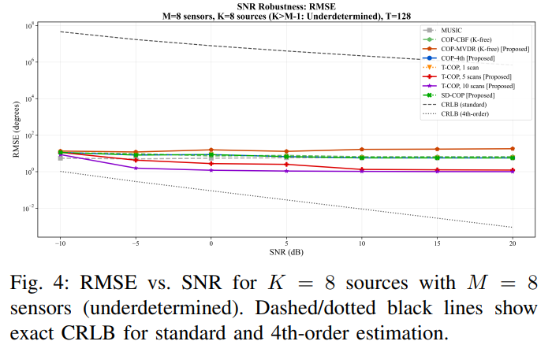
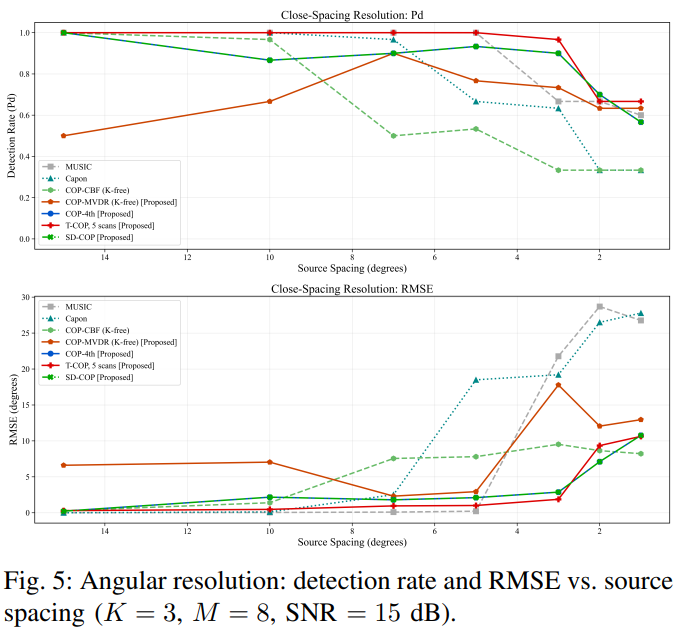
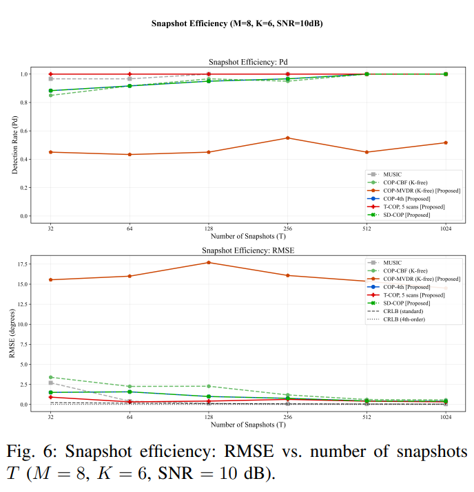
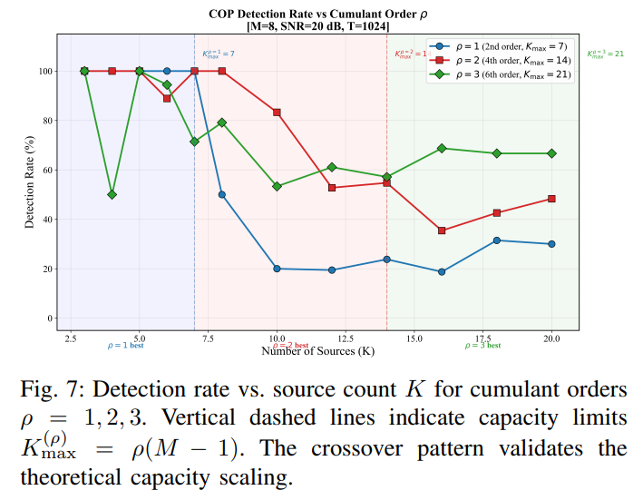
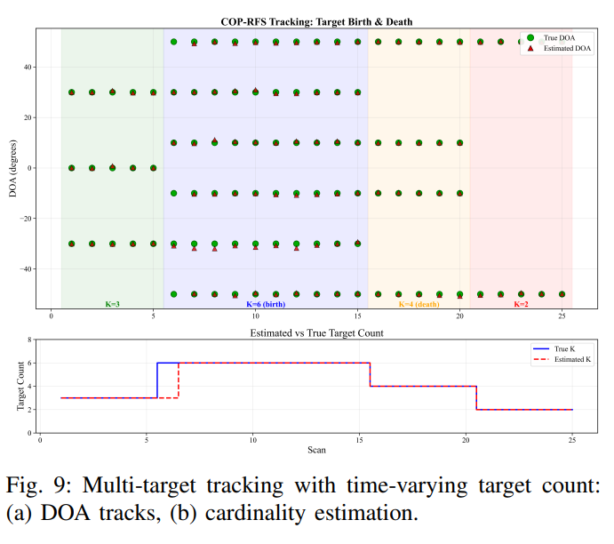
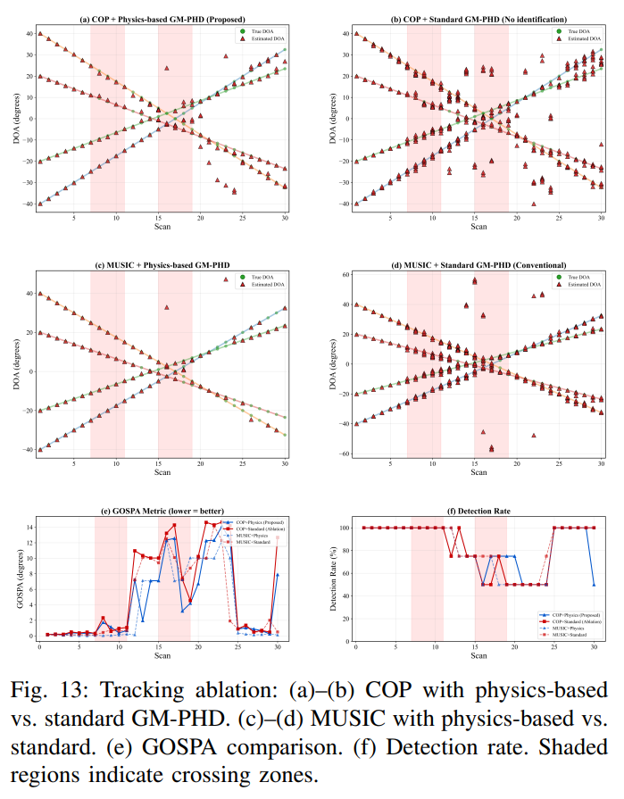

# Breakthrough in Uncertainty: COP-RFS Implements High-Resolution DOA Estimation and Multi-Object Tracking Closed-Loop Fusion [with Python Code]

Breakthrough in Underdetermined Limitations: COP-RFS Achieves High-Resolution DOA Estimation and Multi-Target Tracking Closed-Loop Fusion
This article summarizes the latest results published in IEEE Transactions on Signal Processing, 2026: Underdetermined High-Resolution DOA Estimation and Multi-Target Tracking via COP-RFS.
The topic is based on the underdetermined high-resolution direction of arrival (DOA) estimation and multi-target tracking using COP-RFS.
The paper proposes a closed-loop framework for COP-RFS, tightly coupling the underdetermined DOA estimation with random finite set (RFS) multi-target tracking. This method extends the original pseudospectrum constrained optimization (COP) algorithm by utilizing higher-order cumulants to construct a virtual array. It can resolve up to ρ(M−1) sources with only M sensors, breaking through the resolution limit of traditional methods.
Two key extensions are proposed: Time-Cop (T-COP) with tracker-assisted cumulant accumulation, and Sequential Consolidation COP (SD-COP) based on signal domain iterative shrinkage, respectively enhancing estimation performance in non-stationary scenarios and over-underdetermined scenarios. The tracking back end employs a Gaussian mixture probability hypothesis density (GM-PHD) filter based on physical principles, constructing a predictive-identification-update pipeline. The Hungarian algorithm completes the matching between inertial prediction and COP measurements, and introduces a velocity threshold merge mechanism to avoid trajectory tangling when targets cross.
The core contribution of this framework lies in the bidirectional collaboration between two levels: COP provides high-resolution underdetermined DOA measurements for PHD filters, and trackers feed back predicted DOAs to T-COP for subspace refinement, forming a closed-loop gain that is not possible with a single component. End-to-end experiments show that COP-RFS can resolve all 14 sources with K=14 under the theoretical capacity limit, maintaining sub-degree level tracking root mean square error during the target crossover process, and significantly outperforming traditional MUSIC-PHD pipelines in both scenarios.
Introduction: High-resolution direction of arrival (DOA) estimation is a fundamental problem in array signal processing, with critical applications in radar, sonar, communication, and national defense systems. Classic high-resolution subspace methods (such as MUSIC, ESPRIT, Capon) can break through the Rayleigh limit to achieve super-resolution, but are strictly limited by the deterministic condition of having no more than M−1 sources. In modern national defense scenarios, sensor arrays often face multiple threats beyond their nominal resolution capabilities, presenting a significant bottleneck.
Higher order statistics provide an effective way to overcome this limitation. By utilizing the 2ρ-order cumulant structure of the received signal, the COP algorithm can expand the effective aperture by virtual arrays, achieving far higher resolution capabilities than the traditional M−1 limit without requiring special array structures and directly operating on standard uniform linear arrays. Another advantage of higher order cumulants is their ability to automatically suppress Gaussian noise because the second-order cumulants of Gaussian processes are zero.
Traditional DOA-tracking pipelines typically chain a covariance-based estimator with a Bayesian tracker in an open loop configuration, where the tracker only consumes the estimated result without providing feedback. This design has two major drawbacks: the estimator cannot distinguish sources with K>M−1, and the tracker cannot utilize the higher-order signal structure to improve performance. Although GM-PHD and other RFS tracking methods have been widely studied, they have not been integrated with higher order cumulant estimation at the front end nor established closed-loop feedback between tracking prediction and estimation subspaces.
This article will only extend the COP algorithm for static DOA estimation into a complete estimation-tracking framework, COP-RFS. The core breakthrough is to establish closed-loop feedback between the high-order cumulant front and the RFS tracking back end, achieving synergistic gain between the two.
Method Introduction: For a uniform linear array with M elements, the received signal contains K far-field narrowband sources. The traditional second-order covariance method cannot distinguish all sources when K > M − 1. In this paper, a 2ρ-order cumulative distribution function is used to construct a virtual array. The equivalent array size Mv=ρ(M−1)+1 can resolve up to Kmax=ρ(M−1) sources simultaneously while automatically suppressing Gaussian noise.
II. COP Algorithm Family 1
Basic COP: Subspace decomposition of the virtual accumulation matrix, construction of pseudo-spectrum function, maximizing signal subspace projection and minimizing noise subspace projection to achieve high resolution DOA estimation.
2  
T-COP (Temporal COP): Implements temporal accumulation of cumulative quantities by introducing an exponential forgetting factor, and utilizes the predicted DOA provided by the tracker to construct a prior subspace, completing subspace refinement, thereby enhancing the performance of non-stationary target estimation.
3  
SD-COP (Serial Shrinkage COP): Iterative de-noise in the original received signal domain to avoid error cascading caused by shrinkage in the magnitude domain, and further enhances the resolution capability under overdetermined conditions through multiple rounds of global refinement.
III. Physical-based GM-PHD tracking models multiple target states and measurements as stochastic finite sets, employing a constant velocity motion model. A predictive-identification-update pipeline is proposed:
1  
Based on inertia to complete the target state prediction;
2  
Utilize the Hungarian algorithm to achieve optimal correlation between prediction DOA and measurement.
3  
Speed threshold merger is adopted to avoid the entanglement of cross-target trajectories;
4  
Set the weight of new components based on COP spectrum peak to improve trajectory initialization accuracy;
5  
Differential update strategy is adopted for confirmed trajectory and new component to enhance stability.
4. Theoretical Support and Derivation of the Cramer-Rao Lower Bound (CRLB) for Second-Order and Higher-Order COPs, demonstrating the theoretical performance advantage of higher-order methods; provides proof of geometric convergence in T-COP-PHD closed-loop systems, clarifying the parameter stability domain; derives a closed-form expression for the probability of trajectory identity preservation during target crossing, providing a theoretical basis for cross-tracking robustness.
Conclusion: This paper proposes a COP-RFS closed-loop framework that integrates high-order cumulant-based DOA estimation with RFS multi-target tracking, achieving bidirectional synergistic gain between estimation and tracking. This framework breaks through the traditional M−1 resolution limit, achieves high-resolution DOA estimation under underdetermined conditions, maintains stable tracking in scenarios such as target crossing, maneuvering, appearance, and disappearance, significantly reducing the rate of trajectory identity switching.
Experimental results validate that the COP-RFS outperforms traditional MUSIC-PHD schemes in terms of underdetermined resolution capability, noise-robustness, angle resolution, and multi-target tracking stability. It holds significant application value in fields such as radar, communication, sonar, and other areas where multi-target high-resolution perception is realized by small aperture arrays.
Future work will focus on two-dimensional azimuth-pitch DOA tracking, adaptive motion models, annotated RFS filter upgrades, and real-time embedded implementation directions.

## Images

<!-- PAYMENT_BLOCK -->

## Get this dataset

- Payment link (Stripe): [Buy now](https://buy.stripe.com/3cs8yP7sY87d0vu9AB)
- Payment QR code: 

<!-- /PAYMENT_BLOCK -->
